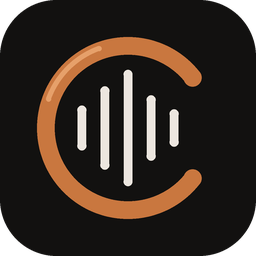

<div align="center">
  
  <h1>Cobre Mobile</h1>
  <p>Player Android integrado ao ecossistema Cobre</p>
  <p><strong>Em desenvolvimento: 0.19.0 — preparação para Google Play</strong></p>
</div>

O código do Cobre é proprietário e está disponível publicamente para inspeção. Consulte o [aviso de licença](LICENSE); componentes de terceiros mantêm suas próprias licenças.

Desenvolvimento principal: Bruno C S Moraes · Contribuição ao projeto: [@dilucas00](https://github.com/dilucas00).

Aplicativo Android do ecossistema Cobre. Interface escura com a paleta, o símbolo e a organização visual do Cobre Desktop, adaptados para toque.

## Última versão publicada: 0.18.0

APK assinado e checksum SHA-256 disponíveis em [Cobre Mobile 0.18.0](https://github.com/bruncosta077-boop/Cobre-Mobile/releases/tag/mobile-v0.18.0). Build, assinatura e publicação passaram no [GitHub Actions](https://github.com/bruncosta077-boop/Cobre-Mobile/actions/runs/45052837954). A release é pré-release; a instalação é manual e não usa a Play Store.

O app verifica novas versões ao abrir e em **Configurações → Aplicativo**. Quando encontra uma atualização, baixa e valida o APK assinado e abre a instalação do Android; o sistema pede autorização para instalar e confirmação final. As notas da versão aparecem antes e depois da atualização.

- Biblioteca local com álbuns, artistas, faixas, capas e busca.
- Pasta de biblioteca configurável pelo seletor de pastas do Android.
- Detalhe do álbum, fila editável, mini player e tela completa com progresso, aleatório e repetição.
- Reprodução em segundo plano pelo Media3 e controles na notificação/tela bloqueada.
- Cobre ID para login, dispositivos e presença; refresh token protegido pelo Android Keystore.
- Permite aprovar pela conta Cobre ID o código de pareamento de um cliente TV compatível e acompanha o dispositivo vinculado.
- Aba de configurações com paletas do Desktop, volume de música e detalhes das saídas informadas pelo Android.
- Favoritos, histórico recente e playlists locais persistidos em SQLite.
- Biblioteca combinada com faixas do Cobre Desktop e reprodução direta pela rede local.
- Nesta versão em desenvolvimento 0.19.0, faixas autorizadas do Desktop podem ser baixadas para ouvir offline. Em **Biblioteca → Computador → Faixas**, toque no ícone de download; elas aparecem em **Baixadas** e o mesmo controle as remove. Os arquivos ficam privados no app e há limite de 2 GB no total e 512 MB por faixa.
- Descoberta automática do Desktop na mesma rede local enquanto a tela Conexões estiver aberta; QR continua disponível.
- Status da conexão Desktop exibe tempo de resposta do catálogo e quantidade de faixas carregadas.
- Filtro entre biblioteca do celular, biblioteca do computador ou visão conjunta sem faixas repetidas; totais e estado Desktop aparecem na biblioteca.
- Player com volume sempre visível, metadados do álbum e ações por toque longo nos álbuns.
- Ícone Cobre incluído no APK em formatos legado e adaptativo.
- Medição do áudio recebido do Desktop (latência inicial e bytes por segundo) enviada ao painel Cobre Server, sem confundir catálogo com stream.
- Backup Android seletivo de playlists, favoritos, histórico, cores, endereço do Server, email, endereço do Desktop e URI da pasta escolhida; tokens não são incluídos, e o Android pode exigir conceder a permissão da pasta novamente após restaurar.
- O APK 0.12.0 usa a chave estável de distribuição armazenada nos segredos do GitHub Actions. A primeira instalação pode exigir uma migração se o app atual foi instalado com assinatura de depuração.
- O Mobile pede permissão ao Desktop através do Cobre ID, acessa biblioteca/capas/áudio protegidos e renova tokens curtos enquanto toca. A permissão é aprovada no Desktop e vale até 30 dias.
- Pareamento do Desktop por QR: o app identifica endereço e dispositivo, solicita acesso via Cobre ID e salva a conexão após a aprovação no computador. O QR expira em cinco minutos e não contém segredo; endereço manual permanece como alternativa.
- Após revogar a permissão ou sair da conta, o endereço antigo com chave LAN não pode reabrir o acesso em silêncio; a autorização Cobre ID será exigida novamente.
- Controles do Cobre ID podem pausar, trocar faixa, ajustar o volume e consultar a faixa em reprodução no Desktop.
- O player foi reorganizado com capa em destaque, origem da faixa, progresso e volume sempre visível; configurações de biblioteca, aparência e áudio continuam agrupadas em cartões por finalidade.
- O equalizador de cinco bandas altera a sessão de reprodução do Android; suas preferências ficam incluídas no backup do app.
- A aba Cobre ID separa estado da conta/dispositivos, autorização do Desktop e pareamento da TV; a tela também lê o estado atual do player Desktop para sincronizar os controles.
- A transmissão de áudio continua direta na rede local entre Desktop e celular; o Cobre Server controla acesso e não retransmite nem armazena arquivos de música.

A conexão LAN e a reprodução Desktop foram validadas pelo autor. As versões assinadas recentes são distribuídas pelas Releases e podem ser instaladas por cima quando assinadas pela mesma chave; cada APK ainda requer confirmação do Android.

**Assinatura e atualizações:** APKs de depuração antigos podem ter certificado diferente e não atualizar por cima. Depois de instalar uma versão de release assinada pela chave estável, atualizações com a mesma chave preservam os dados; o app também confere a assinatura antes de abrir o instalador Android.

## Conexão

O Mobile usa o [Cobre Server](https://github.com/bruncosta077-boop/Cobre-Server/releases/tag/v1.3.0) para login, dispositivos e presença. Para o acesso protegido, entre na mesma conta Cobre ID no Desktop e no Mobile e escolha **Encontrar na rede local** ou escaneie o QR em **Cobre ID**; nos dois casos o Desktop pede aprovação. A descoberta automática requer Cobre Desktop 3.13.0 ou posterior. O QR requer Desktop 3.10.0 ou posterior. Ambos os aparelhos precisam estar na mesma rede local.

O [Cobre TV](https://github.com/bruncosta077-boop/Cobre-TV) segue como protótipo separado para Android TV/Google TV: já lista a biblioteca autorizada, reproduz áudio direto do Desktop e envia presença/diagnóstico ao Server; ainda precisa de validação em TV física e de uma assinatura de distribuição.

O áudio da biblioteca do Desktop é entregue pelo próprio computador na rede local, com autorização curta renovável e requisições por partes para permitir busca na faixa. Essa conexão não passa pelo Cobre Server. Acesso pela internet e sincronização de playlists continuam pendentes; presença do Cobre ID não prova que o computador está alcançável. A integração protegida requer Desktop 3.9.0 e Server beta.9 ou posterior.

## Segurança da conexão

O refresh token do Cobre ID fica protegido pelo Android Keystore. Para conexões HTTP, o app aceita apenas loopback ou endereço IPv4 privado; HTTPS usa a validação padrão de certificados do Android. As requisições de conta e catálogo não seguem redirecionamentos, para evitar encaminhar senhas, tokens ou a chave da biblioteca a outro host. O tráfego HTTP local continua sem criptografia e deve ser usado somente em uma rede Wi-Fi confiável.

## Funções do Desktop ainda ausentes no Mobile

Estatísticas, letras sincronizadas, edição de metadados, créditos de encarte, equalizador e efeitos DSP, crossfade e sincronização de bibliotecas/playlists entre aparelhos.

## Gerar APK de teste

O APK é o instalador padrão do Android. Baixe o arquivo em [Releases](https://github.com/bruncosta077-boop/Cobre-Mobile/releases), abra-o no celular e confirme a instalação. O Android pode pedir permissão para instalar apps baixados pelo navegador.

As versões de desenvolvimento são compiladas pelo GitHub Actions; tags `mobile-v*` publicam o APK de instalação direta e o AAB da variante Play. A versão 0.19.0 ainda está em preparação e não está publicada na Google Play.

Para gerar uma compilação de teste manualmente, abra **Actions**, selecione **Build APK**, clique em **Run workflow** e baixe o artefato `cobre-mobile-debug-apk`.

O workflow também roda ao enviar alterações para `main`. O APK é de depuração e não está assinado para a Play Store.

## Compilar localmente

Requer JDK 17 e Gradle 8.9:

```sh
gradle assembleDebug
```

O projeto não declara uma licença de redistribuição. Consulte o autor antes de reutilizar ou redistribuir o código.

Atualização normal preserva os dados do app. O backup do Android pode restaurar playlists, favoritos, histórico e cores; por segurança, faça login no Cobre ID e reconecte o Desktop/pasta após migrar para outro aparelho. A restauração depende do backup do Android estar habilitado.
